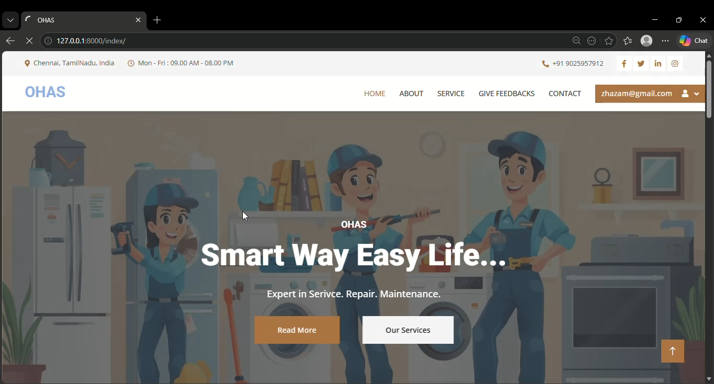
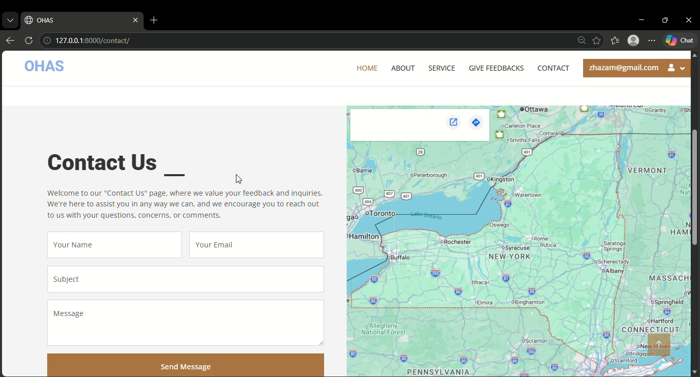
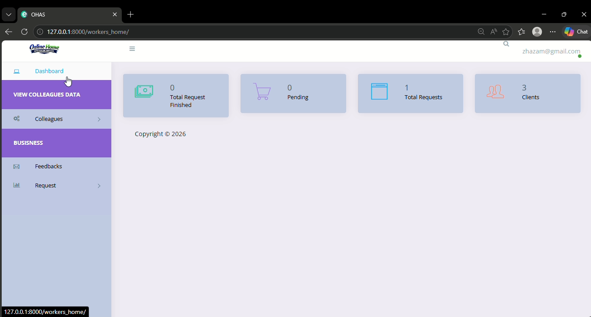
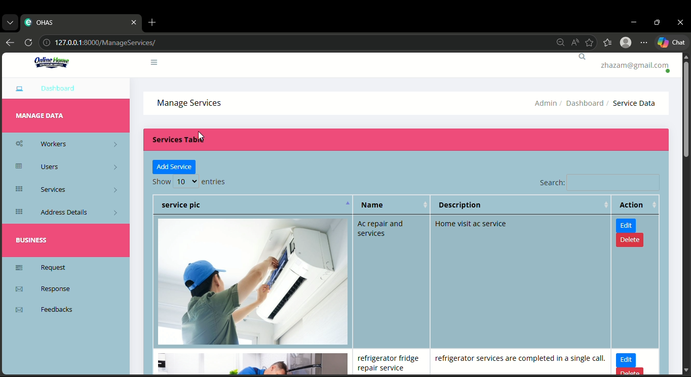

# 🏠 OHAS — Online Home Appliances Services

**Ohas** is a Django-based web platform that connects customers with home appliance service providers (technicians/workers). Users can request repairs and maintenance for appliances like ACs, washing machines, TVs, dishwashers, and refrigerators, while an admin panel handles worker assignment, service categories, and request tracking.

## Homepage


\---

## 📋 Overview

The platform supports three types of participants:

* **Users (Customers)** — browse service categories, raise service requests, track request status, and leave ratings/feedback for workers.
* **Workers (Technicians)** — get assigned to service requests, manage their availability, and complete jobs.
* **Admin** — manages users, workers, service categories, and oversees which worker is assigned to which request.

\---

## ✨ Features

### For Users

* Register/login and manage a personal profile (contact number, address, gender, profile picture)
* Browse available service categories (AC, washing machine, TV, refrigerator, dishwasher, etc.)
* Submit a **service request** with problem description, address, pin code, landmark, and contact details
* Track the status of submitted requests
* Location selection via **Country → State → City**
* Rate and leave feedback (with a rating + description) for the worker who handled a request
* Password reset via token-based flow

### For Workers

* Worker profile with contact info, address, gender, designation, and profile picture
* Account activation controlled by admin (`acc\\\_activation`)
* Availability status toggle (`avalability\\\_status`)
* Get assigned to service requests via the response/assignment system
* Update the status of assigned requests

### For Admin

* Manage user and worker accounts (activation/deactivation)
* Create and manage **service categories** (with image + description)
* Assign workers to incoming service requests
* Track request status and worker responses
* View feedback and ratings submitted by users
* Full Django Admin panel access

\---

## 🗂️ Data Model Summary

|Model|Purpose|
|-|-|
|`Users`|Customer profile (contact, address, gender, profile picture)|
|`Workers`|Technician profile (contact, DOB, address, city, designation, availability, activation status)|
|`ServiceCatogarys`|Service categories offered (name, image, description)|
|`ServiceRequests`|A user's request for a service (problem description, address, pin, house no., landmark, contact, status, linked city/service/user)|
|`Response`|Tracks worker assignment and status for a given service request|
|`Feedback`|User rating \& review for a worker (rating, description, date)|
|`Profile`|Password-reset token handling linked to a user|
|`Country` / `State` / `City`|Location hierarchy used for service requests and worker locations|

*(Derived from the project's database schema.)*

\---

## 🛠️ Tech Stack

* **Backend:** Python, Django
* **Database:** SQLite (default, via `db.sqlite3`) — can be swapped for PostgreSQL/MySQL
* **Frontend:** Django Templates, HTML, CSS, Bootstrap
* **Admin Panel:** Django Admin

> Update this section with your exact Python/Django version and any additional libraries once you export a `requirements.txt` (see below).

\---

## 📁 Project Structure

```
Home\\\_Service\\\_Django\\\_Project/
├── HomeServices\\\_project/     # Django project settings, URLs, WSGI/ASGI config
├── HomeServices\\\_app/         # Main app: models, views, urls, templates, static files
├── media/                    # Uploaded media (profile pictures, service category images)
├── db.sqlite3                # SQLite database
├── manage.py                 # Django management script
└── README.md
```

\---

## 🔑 Usage

* **Users:** Sign up, log in, browse service categories, and submit a service request with your address and issue details.
* **Workers:** Log in to view assigned requests and update job/availability status.
* **Admin:** Log in at `/admin/` to manage users, workers, service categories, and assign workers to incoming requests.

\---

## 🖼️ Screenshots

**Homepage**


**Contact Page**


**Worker Dashboard**


**user– Feedbacks**



